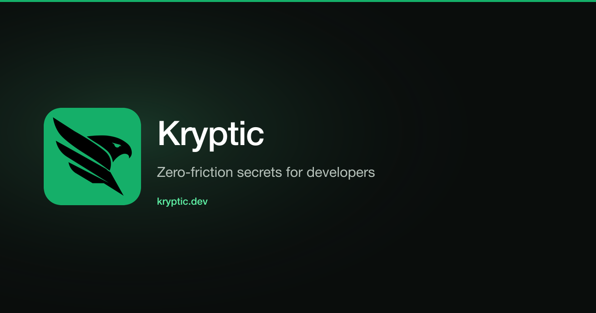

  

  <a href="https://kryptic.dev">Website</a>
  &nbsp;·&nbsp;
  <a href="https://docs.kryptic.dev">Docs</a>
  &nbsp;·&nbsp;
  <a href="https://kryptic.dev/download">Download</a>
  &nbsp;·&nbsp;
  <a href="https://app.kryptic.dev">App</a>
  &nbsp;·&nbsp;
  <a href="https://kryptic.dev/security">Security</a>

Kryptic replaces `.env` files and CLI wrappers with a background daemon. Sign in once. Press run. Secrets arrive over a local socket for .NET, Node.js, Python, Java, Go, Ruby, C++, and Rust.

The repository keeps a `kryptic.json` with a project ID. No tokens, no credentials. Values live in daemon memory, and the platform stores ciphertext it cannot open. Decryption happens on your laptop, in your browser, or on a CI runner that holds a sealed grant.

## Install, then run

1. Install the daemon for Windows, macOS, or Linux from [kryptic.dev/download](https://kryptic.dev/download). On Linux: `curl -fsSL https://kryptic.dev/install.sh | sh`, then `kryptic login`.
2. Add the SDK for your language and commit `kryptic.json`.
3. Start the app the way you already do. F5, `npm run dev`, `dotnet run`. No wrapper command.

## Open source

The daemon is GPL-3.0. The language clients, encryption engines, and Kubernetes operator are Apache-2.0.

### Daemon

| Repository | What it does |
| --- | --- |
| [Kryptic.Daemon](https://github.com/dev-kryptic/Kryptic.Daemon) | Desktop daemon, CLI, and tray. One sign-in, then every SDK on the machine reads secrets from a local socket. |

### Language clients

These packages ask the local daemon for the current project's secrets at startup. If the daemon is not running, the app still starts with the environment it already has.

| Repository | Language |
| --- | --- |
| [Kryptic.Net](https://github.com/dev-kryptic/Kryptic.Net) | .NET |
| [Kryptic.Node](https://github.com/dev-kryptic/Kryptic.Node) | Node.js |
| [Kryptic.Python](https://github.com/dev-kryptic/Kryptic.Python) | Python |
| [Kryptic.Java](https://github.com/dev-kryptic/Kryptic.Java) | Java |
| [Kryptic.Go](https://github.com/dev-kryptic/Kryptic.Go) | Go |
| [Kryptic.Ruby](https://github.com/dev-kryptic/Kryptic.Ruby) | Ruby |
| [Kryptic.Cpp](https://github.com/dev-kryptic/Kryptic.Cpp) | C++ |
| [Kryptic.Rust](https://github.com/dev-kryptic/Kryptic.Rust) | Rust |

### Encryption engines

AES-256-GCM, sealed boxes, and Argon2id. Published so the cryptography can be reviewed on its own.

| Repository | Language |
| --- | --- |
| [Kryptic.Encryption.Net](https://github.com/dev-kryptic/Kryptic.Encryption.Net) | .NET |
| [Kryptic.Encryption.Go](https://github.com/dev-kryptic/Kryptic.Encryption.Go) | Go |
| [Kryptic.Encryption.NPM](https://github.com/dev-kryptic/Kryptic.Encryption.NPM) | TypeScript, WebCrypto |

### Kubernetes, docs, and tests

| Repository | What it does |
| --- | --- |
| [Kryptic.K8s.Operator](https://github.com/dev-kryptic/Kryptic.K8s.Operator) | Syncs a Kryptic project into a native Kubernetes Secret. The operator decrypts inside the cluster. |
| [Kryptic.Docs](https://github.com/dev-kryptic/Kryptic.Docs) | Documentation published at [docs.kryptic.dev](https://docs.kryptic.dev). |
| [Kryptic.All.Language.Packages.Tester](https://github.com/dev-kryptic/Kryptic.All.Language.Packages.Tester) | Integration runners for the daemon, the socket, the packages, and the process environment. |

## Security

Email vulnerabilities to **security@kryptic.dev**. Do not open a public issue. Policy: [kryptic.dev/security/disclosure](https://kryptic.dev/security/disclosure).
